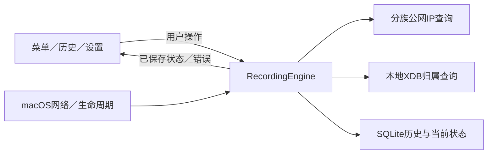

# IP Record 设计

版本：v1.0；日期：2026-11-07（Asia/Taipei）。状态：设计已封版，应用尚未开发。

本文及链接文件是开发依据。15项已确认的产品需求与工程决策分别记录；所有影响主要实现的产品问题已关闭，未执行的运行验证保留为前置验收门。

## 1. 文档导航

- [已确认需求与设计决策](decisions.md)
- [运行、采集、存储与模块设计](runtime-and-data.md)
- [界面与 IP 展示规则](ui.md)
- [验收、场景检查与开发顺序](acceptance.md)
- [领域用语](../../GLOSSARY.md)
- [macOS 技术依据与证据限度](../research/macos-feasibility.md)
- [已下载数据库与手动查询工具](../../README.md)

## 2. 产品定位和范围

本机自用的原生 macOS 菜单栏应用，用来回看这台 Mac 的 IP 和网络配置变化。

用户已确认：

1. 静默运行，保留菜单栏小图标，无 Dock 图标。
2. 记录公网 IP 和本机接口 IP，公网每约 5 分钟检查，优先省电。
3. 公网出口沿用系统网络与代理行为，不区分或绕过直连、代理、VPN。
4. 通过本地全球 IPv4／IPv6 数据库查询国家、省市和网络归属，不调用在线归属地接口。
5. 增加接口名称、连接方式、网络状态、系统报告网关、DNS 和代理配置。
6. IPv4 优先展示，IPv6 和其他接口展开查看。
7. 仅变化时新增历史，首次打开后默认登录启动，历史长期保存，可手动清空。
8. 第一版仅支持自己的这台 Apple Silicon Mac，不承担其他系统兼容或对外分发。
9. 采用已讨论的菜单／历史／设置布局及默认操作，保留可筛选的记录空档标记。
10. 第一版归属库随应用更新，不提供运行时数据库联网更新；清空历史保留当前状态、设置和归属库。

本轮不纳入：Wi-Fi 名称／BSSID、系统定位、抓包、DNS 泄漏测试、带宽测速、流量统计、VPN 控制、云同步、地图、账号体系和通知告警。公网 IP 发现仍需联网；归属地查询和历史查看完全在本地。

## 3. 正确性约束

- 公网地址是指定查询目标看到的出口，不是对全部网络流量的证明。
- 本机可同时有多个 IPv4／IPv6；本机 IPv6 和公网探测 IPv6 不得互相替代。
- 查询失败不产生地址 `0.0.0.0`、`::` 或空字符串；未知、未配置、失败必须分开。
- 旧地址只能以“上次记录”显示；不得在新网络、睡眠或失败后继续冒充刚确认的地址。
- IPv4／IPv6 各自有结果、来源和最近确认时间。一族失败不覆盖另一族成功。
- “正在检查”是临时界面状态，不是每 5 分钟新增一次历史的理由。
- 同一状态的重复确认可以更新当前记录的确认时间，不新增历史行。
- 时间表示观测事实；不根据离散观测推断连续在线、睡眠期间地址或精确切换时刻。
- 历史归属地保留当时使用的数据版本，更新数据库不追溯改写历史。
- 错误应局部降级：归属库故障不丢 IP，公网查询失败不丢本机信息，登录启动失败不阻止手动运行。

## 4. 确定的技术路线

| 选择 | 决策与理由 | 验证状态 |
| --- | --- | --- |
| 语言／平台 | Swift 6、macOS 27、arm64，仅当前本机 | 已检查环境，未构建应用 |
| 运行形态 | 单进程 `.app`，`LSUIElement=true`，无后台 helper | 官方能力已核实 |
| 菜单与窗口 | AppKit `NSStatusItem`；SwiftUI 内容承载于 `NSPopover`、`NSWindow` | 待菜单及焦点实机验收 |
| 调度 | 系统事件＋5 分钟宽容定时器，睡眠不唤醒 | 待实现 |
| 网络信息 | `NWPathMonitor`、`getifaddrs`、公开 SystemConfiguration | 可读取范围已核实；真实配置切换待验收 |
| 公网检查 | 默认系统配置的短时 `URLSession`，分族 HTTPS ipify 端点 | 文档已核实；当前网络可达性未实测 |
| 本地归属 | 官方 ip2region C 读取器，Swift 封装，串行文件读取 | Python 查询已验证；Swift/C 未验证 |
| 历史 | 系统 SQLite3，单写入执行域，事务和版本迁移 | 待实现 |
| 构建／安装 | SwiftPM＋打包脚本＋本地签名，固定安装至 `~/Applications/IP Record.app` | CLT 已存在；打包／签名待验收 |
| 登录启动 | 优先 `SMAppService.mainApp`，状态与系统同步 | 签名和真实重新登录待验收 |

不用 Electron、WebView、常驻 Python 或周期性 shell 命令。非沙盒本机应用使用当前用户权限；不要求 root、定位或网络扩展权限。以上都是路线选择，不代表运行验证已完成。

AppKit 控制进程、焦点和窗口；选择 SwiftUI 只为简化声明式内容，不让 UI 决定采集调度。标准 NSMenu 是 popover 在键盘／辅助功能验收不达标时的退路，字段与行为合同不变。

## 5. 主要 Module 和 Interface

| Module | 对外 Interface | 内部责任 |
| --- | --- | --- |
| RecordingEngine | `start`、`pause`、`resume`、`checkNow`、状态流、`stop` | 轮次合并、上下文隔离、状态转换、变化判定、持久化协调 |
| NetworkSnapshotter | `readSnapshot`、变动通知 | 本机接口和配置采集、字段来源、缺失／读取失败区分 |
| PublicIPProbe | `probe(family, cancellation)` | HTTPS、地址族验证、超时、错误归类、沿用系统路由 |
| GeoResolver | `lookup(address)`、数据库健康状态 | XDB 版本和完整性、C 资源管理、字段转换、小缓存 |
| HistoryStore | `applyCheck`、分页／筛选、导出快照、清空／迁移 | SQLite 事务、当前状态、变化历史、数据版本 |
| AppShell | 用户动作、当前状态和历史视图 | 菜单栏、窗口、复制、登录项、设置与文件选择 |

状态只由 RecordingEngine 推进；AppShell 不直接执行 SQL、请求公网或调用 C 读取器。
测试替换实际会变化的 Seam：网络、时间与生命周期输入；存储测试使用临时真实 SQLite，不额外建设通用 Repository 框架。
主线程只处理 UI。C 句柄与 SQLite 连接各有明确的串行所有者，不能把非 Sendable 指针跨 actor 传递。

## 6. 设计结束标准

设计结束意味着下面各项闭环，不意味着应用尚未开发就已获得运行保证：

1. 所有影响范围、记录语义、持久化和主要交互的用户决策已确认或明确授权采用建议。
2. 正常、缺失、失败、暂停、睡眠、重启、切换网络等情况都有展示与数据行为。
3. 每一条需求都有可执行的验收场景；无“开发时再决定”的结构性空白。
4. 技术事实有第一方依据；必须实机证明的部分已有早期验收门与失败退路。
5. 文档间无互相冲突的字段、状态、默认值和操作语义。

尚未完成的运行验证不能标记通过。若早期验收发现平台限制，先按已写明的退路收敛；改变用户已确认语义时重新讨论设计。

## 7. v1.0 封版记录

2026-11-07 23:39（Asia/Taipei）：完成三轮产品选择，确认U01–U15；无待用户回答项。完成技术事实独立核对与修订，并核查8个Markdown文件、11个本地链接和代码块闭合，未发现断链或编号缺漏。

核对后已修订：事件epoch与内容指纹分离以处理A→B→A；禁用HTTP缓存和交互认证；原生读取前的可信校验与C buffer释放；不可变首次快照和可变确认摘要；清空历史的外键／序列；导出长读事务上限；事件限频；暂停、睡眠和存储故障的独立控制维度。

已写入7个原生前置验收门、38个行为场景、资源预算和需求对应表。当前未执行原生构建／Swift-C集成／公网端点／睡眠／重登录测试；既有Python数据库样例不替代这些检查。

后续开发从前置验收门开始。范围、数据和失败语义已明确，不需要把结构性需求留给开发时猜测；真实运行结果决定技术验收是否通过，不由文档封版代替。
